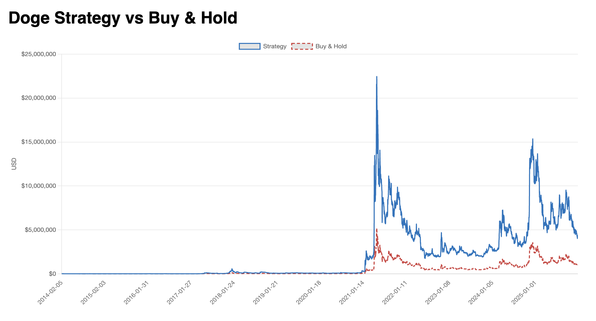
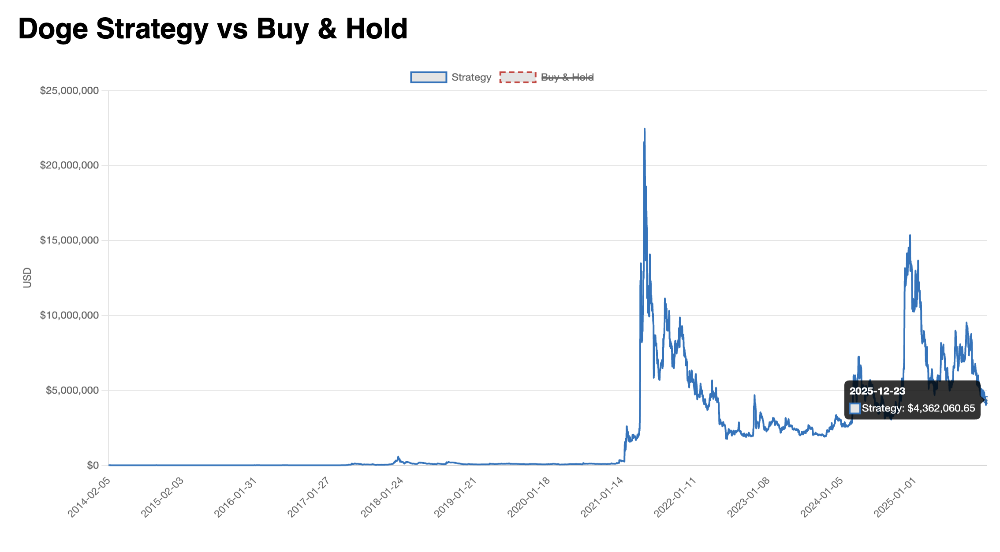
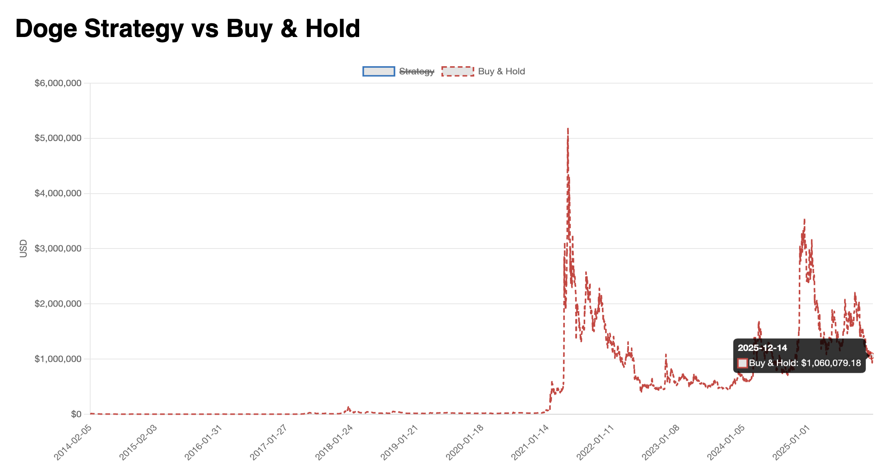
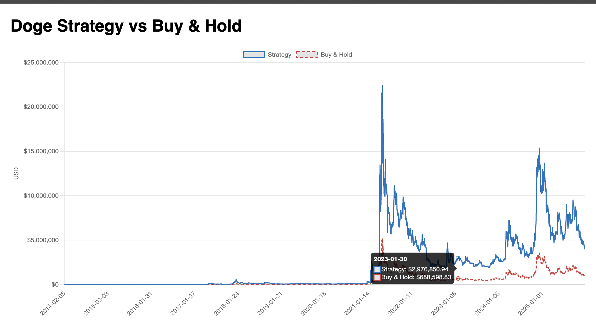

# Dogecoin Breakout Strategy Backtest

A single-file C++17 backtest of a simple breakout strategy on Dogecoin, compared against buy-and-hold over the same window, with an interactive Chart.js equity curve.

## Strategy

- **Entry:** buy when the daily close rises above the highest close of the previous N days (default 50)
- **Exit:** sell when the close falls X% below the entry price (default 30%)
- **Position:** one position at a time, fully invested or fully in cash
- **Costs:** 10 basis points charged on every buy and sell
- **Capital:** USD 10,000 starting capital
- **Benchmark:** buy-and-hold from the first tradable day

## Data

`doge_price_2.csv` holds daily Dogecoin closing prices (with market cap and volume) from December 2013 to December 2025, about 4,400 rows. The parser accepts `,` or `;` as the delimiter. After the 50-day warm-up, the backtest runs from February 2014 to December 2025.

## Results

| | Strategy | Buy-and-hold |
|---|---|---|
| Ending equity (from USD 10,000) | ~USD 4.36M | ~USD 1.01M |
| Maximum drawdown | ~-92% | ~-95% |



The interactive chart is in [`equity_full.html`](equity_full.html) (open it in a browser).

## How to read these results

These numbers are **not** evidence of a reliable edge, and I would not trade the strategy on this basis:

- **In-sample only.** The lookback and stop-loss were set on the same data they were tested on, with no out-of-sample or walk-forward test.
- **One parameter set.** No sensitivity check across other lookbacks or stop levels.
- **Same-close execution.** Signals are computed and filled at the same day's close, which is slightly optimistic.
- **One asset, one regime.** Most of the gain comes from Dogecoin's 2021 rally. Both curves still suffer drawdowns of over 90%.

My later cross-asset momentum project applies a stricter process: a one-day lag between signal and trade, volatility-based sizing, net-of-cost returns and an out-of-sample check.

## Run it

```bash
g++ -std=c++17 -O2 -o doge_backtest doge_backtest.cpp
./doge_backtest doge_price_2.csv equity_full
```

Outputs:
- `equity_full.csv`: daily equity for the strategy and buy-and-hold
- `equity_full_data.json`: chart data
- `equity_full.html`: interactive equity curve

## Parameters

Change these in `main()` / `backtest()`:

```cpp
int    LOOKBACK      = 50;      // N-day high for entry
double STOP_LOSS     = 0.30;    // 30% stop from entry price
double START_CAPITAL = 10000.0; // starting capital in USD
double fee_bps       = 10.0;    // trading cost per side, in basis points
```

## Tech

- C++17, single file, no external dependencies
- Custom CSV parser
- Chart.js v4 for the equity curve

## More screenshots




